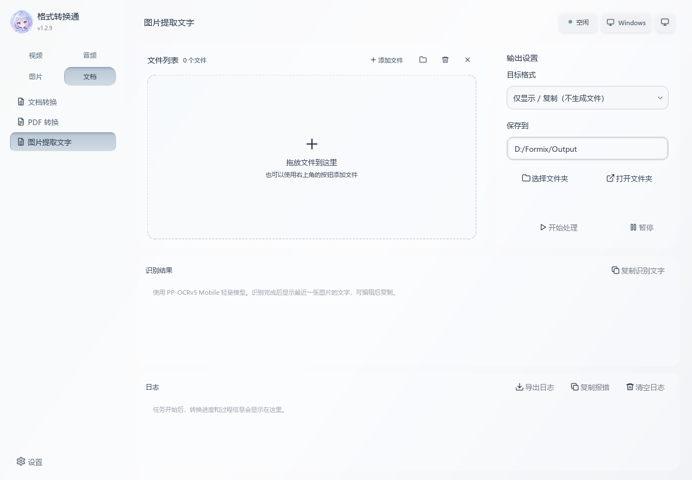
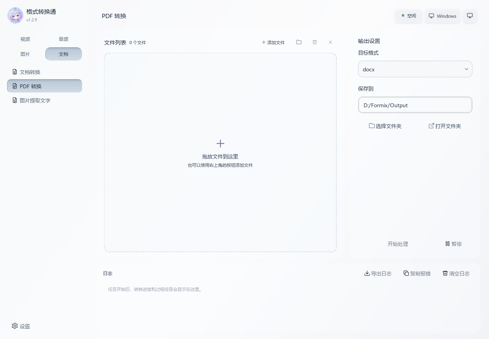
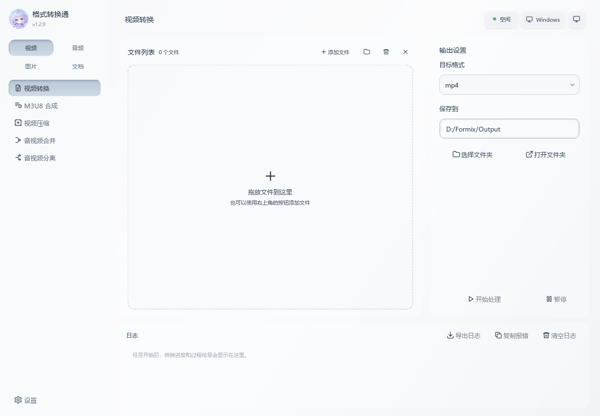
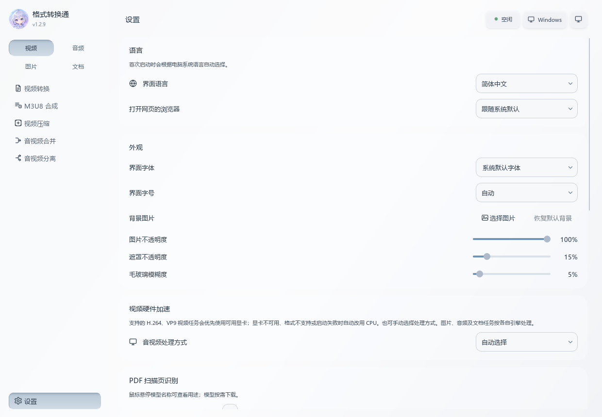

# 格式转换通 · Formix

[简体中文](README.md) · [English](README_EN.md)

**把常用的音视频、图片和文档处理，放进一个简单清爽的桌面工具。**

格式转换通（Formix）是一款面向 Windows、macOS 和 Linux 的开源文件转换工具。拖入文件即可开始，按文件类型进入对应功能页；格式选择、压缩参数、任务进度和运行日志都集中在一个界面里。

> 当前项目仍在持续开发中。不同平台、输入格式和引擎版本可能影响可用的转换选项；遇到问题欢迎提交 Issue，并附上系统版本、输入格式和日志。

## 软件预览

中文界面实拍 · 点击缩略图查看完整截图。

<table>
  <tr>
    <th align="center">图片提取文字</th>
    <th align="center">PDF 转换</th>
  </tr>
  <tr>
    <td align="center"></td>
    <td align="center"></td>
  </tr>
  <tr>
    <th align="center">视频转换</th>
    <th align="center">设置</th>
  </tr>
  <tr>
    <td align="center"></td>
    <td align="center"></td>
  </tr>
</table>

## 为什么选择 Formix

- **一处处理多种文件**：音频、视频、图片、文档和 PDF 功能分开，操作路径清楚。
- **拖放即用**：将文件拖进窗口，会根据格式切换到相应页面并加入列表。
- **批量排队处理**：任务逐个执行，界面仍可操作；可查看进度、暂停任务并查看每个功能页自己的日志。
- **参数够用，不堆复杂选项**：常见目标格式优先，也保留一些较少见的格式；压缩可按需要调整分辨率或音频参数。
- **尽量利用可用硬件**：兼容的格式可使用显卡编码；不适用时使用 CPU，也可在设置里选择处理方式。
- **保留文件信息**：转换与压缩时尽量保留音频标签、视频流信息和图片元数据；具体保留情况取决于输入格式和目标格式。
- **可选 PDF 视觉模型**：模型由用户在设置中按需下载，不随源码或安装包默认附带。
- **按喜好调整界面**：支持明暗主题、系统语言自动识别、背景图与字体设置，并提供简体中文、繁體中文、English、日本語、한국어、Русский和Français。
- **跨平台界面**：Windows、macOS、Linux 使用同一套 Qt 桌面界面，平台安装包只包含相应系统的依赖。

文件转换在本机处理。应用会连接 GitHub 检查软件和引擎更新；下载 PDF 模型时会连接对应模型仓库。网络 M3U8 功能则需要访问播放列表引用的资源。

## 功能一览

| 分类 | 功能 | 说明 |
| --- | --- | --- |
| 视频 | 视频转换 | 转换常用及部分专业视频格式；可按需设置输出分辨率。 |
| 视频 | 视频压缩 | 选择压缩方案，并设置分辨率上限。兼容时可使用显卡编码。 |
| 视频 | M3U8 合成 | 合成本地或网络 M3U8 点播列表，输出为常见视频文件。 |
| 音频 | 音频转换 | 转换音频格式；支持导入网易云 NCM 文件，解密后继续转换。 |
| 音频 | 音频压缩 | 调整压缩方案及可用的音频参数。 |
| 音视频 | 音视频合并 | 将视频与单独的音轨合成为一个文件。 |
| 音视频 | 音视频分离 | 从视频中提取音频或视频流。 |
| 图片 | 图片转换 | 转换常见图片格式；ICO 可生成 32、64、128 像素图标。支持导入 Adobe Illustrator 的 `.ai` 文件进行图片输出。 |
| 图片 | 图片压缩 | 按图片格式选择相应的压缩方式，并尽量保留可写入的元数据。 |
| 文档 | 文档转换 | 转换常见办公文档格式；可用格式取决于文档类型和本机文档引擎。 |
| 文档 | 图片提取文字 | 本地轻量 OCR；批量识别图片，编辑并复制结果，或导出 TXT / Markdown。 |
| 文档 | PDF 转换 | 提取 PDF 文字并导出为可用格式；扫描件可在设置中按需下载视觉识别模型。 |

## 新增与改进

- **图片提取文字**：在“文档”分类中批量导入 PNG、JPEG、BMP、WebP 或 TIFF。使用 PP-OCRv5 Mobile 轻量模型，支持多页 TIFF；识别结果位于日志上方，可编辑后复制。
- **三种结果方式**：默认仅显示文字、不生成文档文件；也可选择导出 TXT 或 Markdown。识别在独立进程运行。
- **PDF 版式还原**：有文字层的 PDF 优先保留原始文字、字体、加粗、图片和表格，改善续行分段与内容裁剪；扫描件使用所选模型识别。还原效果取决于源文件和模型。
- **记住模型选择**：重启后恢复上次选择的 PDF 模型。不同模型使用各自的适配与运行依赖。
- **文档属性更干净**：PDF 转 Office 文件保留源文件已有作者，不额外添加作者；清空生成工具备注，创建与最后保存时间使用本次转换时间。
- **缓存与日志**：转换中间文件、依赖下载临时文件集中放在缓存目录；完成后发布到指定输出位置。运行日志记录任务和错误，便于排查问题。

## 使用教程

### 1. 下载并启动

打开 [GitHub Releases](https://github.com/xiaofa520/Formix/releases)，下载与系统匹配的安装包：

- **Windows**：下载 `.exe` 安装程序，按提示安装后启动“格式转换通”。
- **macOS**：下载对应架构的 `.pkg` 安装包并完成安装。
- **Linux**：下载对应平台的压缩包，按随包说明启动。

请从 GitHub Releases 下载正式版本。不同系统的安装包只包含对应平台的运行依赖。

### 2. 添加文件

1. 从左侧选择音频、视频、图片或文档分类。
2. 点击文件列表右上角的“添加文件”，也可以把文件直接拖到应用窗口。
3. 拖入的文件会按格式自动进入对应功能页；文件名和大小会显示在列表中。
4. 可一次添加多个文件，任务会依次排队处理。

### 3. 设置输出

1. 在左侧选择具体功能，例如“视频转换”或“图片压缩”。
2. 在“输出设置”中选择目标格式或压缩方案。
3. 如需调整画面尺寸，在分辨率输入框输入 `1920x1080`、`1920*1080` 或 `1920 1080`。留空或选择“保持原分辨率”会沿用源文件尺寸。
4. 查看保存位置；需要改位置时点击“选择文件夹”。

不同输入格式会显示适用的目标格式和压缩参数。某些格式没有意义或不兼容的选项不会提供。

### 4. 开始、暂停和查看进度

点击“开始处理”启动队列。文件列表会显示当前状态和进度，页面下方的日志显示转换过程及结果。暂停后可继续处理；取消或失败的任务不会被当作成功文件保留。不同功能页的日志互相独立，可在相应页面导出日志。

### 5. 设置与可选模型

在“设置”中可以切换界面语言和明暗主题、设置背景与字体、检查软件或转换引擎更新，并选择显卡处理方式。PDF 视觉模型不会自动下载；需要扫描件识别时，再到设置中选择模型并按提示下载。下载前可查看模型所需空间和当前可用内存。

### 6. 从图片提取文字

1. 打开“文档 → 图片提取文字”，添加一张或多张图片。
2. 首次使用时，在设置中下载 **PP-OCRv5 Mobile** 轻量模型。
3. 选择输出方式：
   - **仅显示 / 复制**：不生成文档文件；识别结果显示在日志上方，可编辑后点击“复制识别文字”。批量识别时显示最近完成的图片结果。
   - **TXT / Markdown**：选择保存位置，逐张导出文字文件；识别结果区自动隐藏。
4. 点击“开始处理”。需要同时保留多张图片的文字时，选择文件导出模式。

清晰、端正的印刷文字更容易识别；低分辨率、手写或复杂排版图片请核对结果。

## 更新与问题反馈

应用会在打开设置时尝试从 GitHub 加载更新公告；离线时显示上次缓存的公告。软件更新与 FFmpeg、libvips、LibreOffice 引擎更新分别管理。引擎更新完成校验和试运行后才会切换版本，更新失败会继续使用旧版本。

- [查看最新版本](https://github.com/xiaofa520/Formix/releases)
- [报告问题或提出建议](https://github.com/xiaofa520/Formix/issues)
- [项目主页](https://formix.xiaofa520.cn/)

提交问题时，请尽量提供操作系统及版本、输入文件类型、目标格式、出错页面的日志，以及是否开启了 GPU 或使用了模型。请不要上传含有私人内容的文件；可以先用虚构或公开样例复现。

## 从源码运行

Windows 安装完成后，从开始菜单打开「格式转换通」即可。应用自带 Python。开发者在源码工作区准备好内置环境后，可运行 `.\build\app\python\python.exe -I .\main.py` 调试。

部分转换功能需要对应引擎。Windows 正式安装包会携带所需运行环境；源码运行时若缺少引擎，应用会提示处理方式。模型权重仍由用户在设置页按需下载。

## Star History

如果 Formix 对你有帮助，欢迎给项目点个 Star，帮助更多用户发现它。

<a href="https://www.star-history.com/?repos=xiaofa520%2FFormix&amp;type=date&amp;legend=bottom-right">
  <picture>
    <source media="(prefers-color-scheme: dark)" srcset="https://api.star-history.com/chart?repos=xiaofa520/Formix&amp;type=date&amp;theme=dark&amp;legend=bottom-right" />
    <source media="(prefers-color-scheme: light)" srcset="https://api.star-history.com/chart?repos=xiaofa520/Formix&amp;type=date&amp;legend=bottom-right" />
    
  </picture>
</a>

## 官方反馈群

使用中遇到问题，或有功能建议，欢迎加入 QQ 群交流。

[点击链接加入群聊【Formix（格式转换通）反馈问题官方群】](https://qm.qq.com/q/SluGNXFwku)

反馈时请附上软件版本、操作系统、复现步骤及相关错误日志，方便定位问题。
