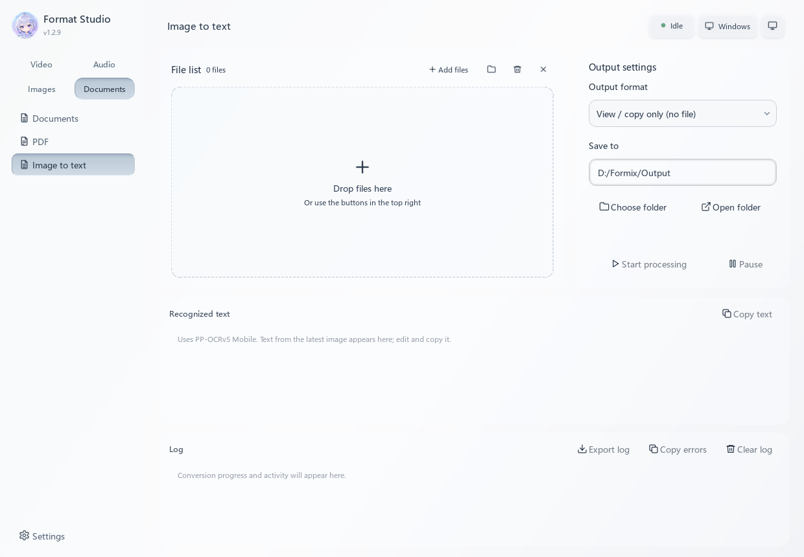
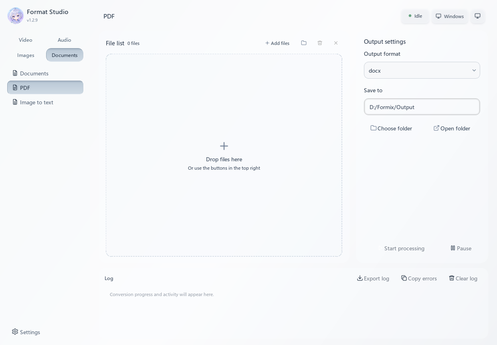
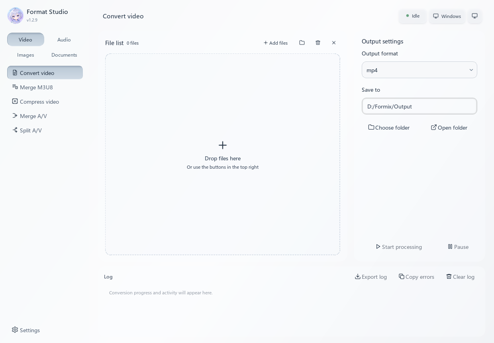
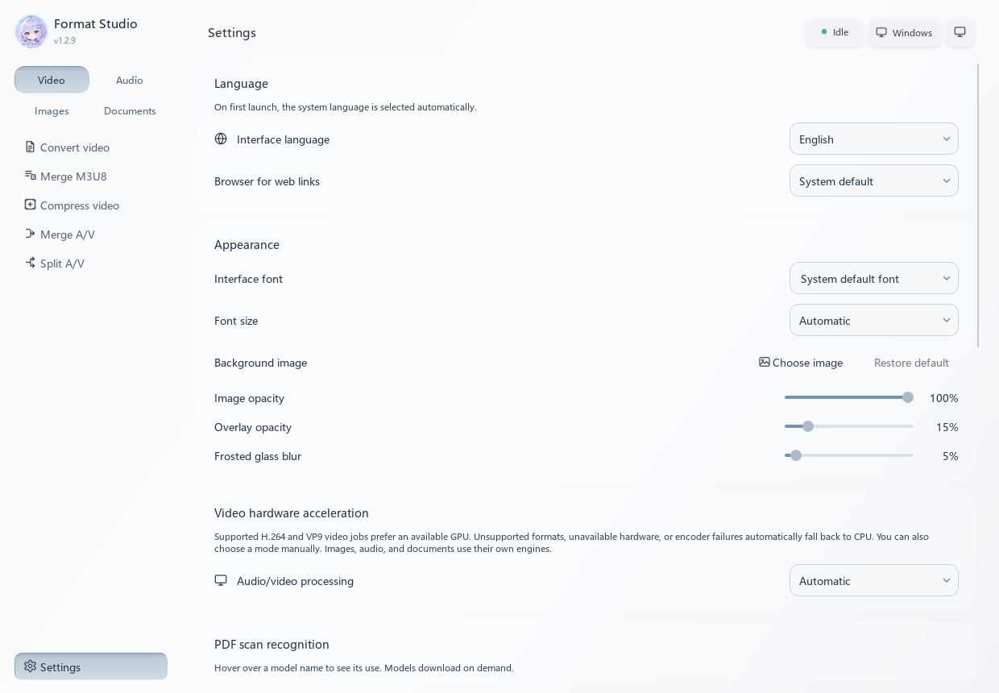

# Formix · Format Converter

[简体中文](README.md) · [English](README_EN.md)

**Audio, video, image, and document tools in one clean desktop app.**

Formix is an open-source file conversion app for Windows, macOS, and Linux. Drop files into the window to route them to the right tool. Choose an output format, tune a few practical settings, and follow the queue, progress, and logs in one place.

> Formix is under active development. Available options can vary by operating system, input format, and engine version. If something goes wrong, please open an issue with your OS version, input format, and the relevant log.

## App preview

Captured from the English interface. Click a thumbnail to view the full screenshot.

<table>
  <tr>
    <th align="center">Image to text</th>
    <th align="center">PDF conversion</th>
  </tr>
  <tr>
    <td align="center"></td>
    <td align="center"></td>
  </tr>
  <tr>
    <th align="center">Video conversion</th>
    <th align="center">Settings</th>
  </tr>
  <tr>
    <td align="center"></td>
    <td align="center"></td>
  </tr>
</table>

## Why Formix

- **One app for everyday file work:** Separate tools for audio, video, images, documents, and PDFs keep each workflow easy to follow.
- **Drop files and get started:** Formix detects file types, opens the matching page, and adds the files to the list.
- **Batch processing with a responsive UI:** Jobs run in a queue. Track progress, pause work, and view logs for each tool page independently.
- **Useful settings without a maze of options:** Common output formats come first, with less common formats available too. Adjust video resolution or audio parameters when needed.
- **Make use of compatible hardware:** Supported formats can use GPU encoding. Formix falls back to CPU when GPU encoding is unavailable, and you can choose the processing mode in Settings.
- **Preserve file information where possible:** Formix attempts to retain audio tags, video stream information, and image metadata. Results depend on the source and target formats.
- **Optional PDF vision models:** Models are downloaded from Settings when you need them; model weights are not bundled with the source or installer.
- **Consistent cross-platform UI:** Windows, macOS, and Linux share the same Qt desktop interface. Each platform package contains dependencies for that platform.
- **Make the interface your own:** Choose light, dark, or system appearance; customize backgrounds and fonts; use Simplified Chinese, Traditional Chinese, English, Japanese, Korean, Russian, or French.

File conversion runs locally. The app connects to GitHub for software and engine updates, and to the model repository when you download a PDF vision model. Online M3U8 workflows access the resources referenced by the playlist.

## Features

| Category | Tool | What it does |
| --- | --- | --- |
| Video | Video conversion | Convert common and selected specialist formats; set an output resolution when needed. |
| Video | Video compression | Choose a compression preset and resolution limit. GPU encoding is used when compatible. |
| Video | M3U8 merge | Combine a completed local or online M3U8 playlist into a common video file. |
| Audio | Audio conversion | Convert audio formats, including NetEase Cloud Music NCM files. |
| Audio | Audio compression | Select a compression preset and adjust available audio parameters. |
| Audio/video | Merge | Combine a video with a separate audio track. |
| Audio/video | Split | Extract the audio or video stream from a video. |
| Image | Image conversion | Convert common image formats. Export ICO icons at 32, 64, or 128 px; import Adobe Illustrator `.ai` files for image output. |
| Image | Image compression | Use a compression method suited to the image format, while retaining writable metadata where possible. |
| Documents | Document conversion | Convert common office documents; available targets depend on the document type and installed document engine. |
| Documents | Image to text | Local lightweight OCR with batch image import, editable text, copying, and TXT / Markdown export. |
| Documents | PDF conversion | Extract PDF text to supported formats. Scanned documents can use an optional vision model downloaded from Settings. |

## New and improved

- **Image to text:** Import PNG, JPEG, BMP, WebP, or TIFF files in the Documents category. Uses the lightweight PP-OCRv5 Mobile model and supports multipage TIFF. Edit and copy recognized text in the panel above the log.
- **Three output choices:** View and copy text without creating a document file, or export TXT or Markdown. Recognition runs in a separate process.
- **PDF layout preservation:** PDFs with a text layer prioritize original text, fonts, bold styling, images, and tables, with improved paragraph continuation and clipping handling. Scans use the selected recognition model. Fidelity depends on the source and model.
- **Remembered model selection:** The last selected PDF model is restored on restart. Models have dedicated adapters and runtime dependencies.
- **Cleaner document properties:** PDF-to-Office output retains an existing source author without adding a new one, removes generator comments, and uses the conversion time for creation and last-save timestamps.
- **Cache and diagnostics:** Conversion intermediates and dependency download temporary files use the cache directory. Completed files are published to the selected output location; runtime logs record tasks and errors for troubleshooting.

## Quick start

### 1. Download and launch

Open [GitHub Releases](https://github.com/xiaofa520/Formix/releases) and download the package for your operating system:

- **Windows:** Download the `.exe` installer, follow the setup prompts, then launch Formix.
- **macOS:** Download and install the `.pkg` package for your system architecture.
- **Linux:** Download the package for your platform and follow the included launch instructions.

Download official releases from GitHub. Each installer contains runtime dependencies for its target platform.

### 2. Add files

1. Choose the Audio, Video, Image, or Documents category in the sidebar.
2. Select **Add files** in the file list, or drop files anywhere in the app window.
3. Dropped files are routed to the matching tool page. The list shows file names and sizes.
4. Add multiple files at once; jobs are processed in order.

### 3. Choose output settings

1. Select a tool, such as **Video conversion** or **Image compression**.
2. Choose the target format or compression preset under **Output settings**.
3. To set a video resolution, enter `1920x1080`, `1920*1080`, or `1920 1080`. Leave the field empty or choose **Keep original resolution** to use the source dimensions.
4. Review the output folder. Select **Choose folder** to change it.

Formix shows options that apply to the selected input. Unsupported or irrelevant settings are omitted.

### 4. Process and track jobs

Select **Start processing** to run the queue. The file list shows each job's state and progress; the log below shows processing details and results. Pause and resume work as needed. Incomplete or failed outputs are not treated as successful files. Logs are separate for each tool page and can be exported from that page.

### 5. Settings and optional models

In **Settings**, choose the interface language and appearance, customize the background or font, check for app and engine updates, and select a GPU processing mode. PDF vision models are not downloaded automatically. For scanned documents, choose a model in Settings and follow the download prompts. The model's storage requirements and available memory are shown before download.

### 6. Extract text from images

1. Open **Documents → Image to text** and add one or more images.
2. For first use, download the lightweight **PP-OCRv5 Mobile** model in Settings.
3. Choose an output mode:
   - **View / copy only (no file):** Edit and copy text in the result panel above the log. Batch processing shows the most recently completed image.
   - **TXT / Markdown:** Choose an output folder and export a text file for each image. The result panel is hidden automatically.
4. Select **Start processing**. Use file export when you need to retain the results from every image in a batch.

Clear, upright printed text works best. Review results from low-resolution images, handwriting, or complex layouts.

## Updates and support

When Settings opens, Formix checks GitHub for the latest release notes; if the app is offline, it shows the last cached notice. App updates are managed separately from FFmpeg, libvips, and LibreOffice engine updates. A replacement engine is activated only after download validation and a trial run; if an update fails, the previous version remains in use.

- [Download the latest release](https://github.com/xiaofa520/Formix/releases)
- [Report a problem or suggest an improvement](https://github.com/xiaofa520/Formix/issues)
- [Visit the project website](https://formix.xiaofa520.cn/)

When reporting a problem, include your operating system and version, input format, target format, the relevant page log, and whether GPU encoding or a model was involved. Please do not upload files containing private information; use a synthetic or public sample when possible.

## Run from source

After installing Formix on Windows, open it from the Start menu. The app includes Python. Developers can run `.\build\app\python\python.exe -I .\main.py` in a source checkout with the bundled runtime and dependencies prepared.

Some tools require their corresponding engines. If an engine is missing, the app will explain the available setup options. PDF model weights remain optional and can be downloaded from Settings.

## Star History

If Formix is useful to you, consider starring the project to help more people find it.

<a href="https://www.star-history.com/?repos=xiaofa520%2FFormix&amp;type=date&amp;legend=bottom-right">
  <picture>
    <source media="(prefers-color-scheme: dark)" srcset="https://api.star-history.com/chart?repos=xiaofa520/Formix&amp;type=date&amp;theme=dark&amp;legend=bottom-right" />
    <source media="(prefers-color-scheme: light)" srcset="https://api.star-history.com/chart?repos=xiaofa520/Formix&amp;type=date&amp;legend=bottom-right" />
    
  </picture>
</a>

## Official feedback group

Report problems, share suggestions, and discuss Formix in our official QQ group.

[Join the Formix official feedback group · Formix（格式转换通）反馈问题官方群](https://qm.qq.com/q/SluGNXFwku)

Please include your app version, operating system, steps to reproduce, and relevant error logs when reporting an issue.
